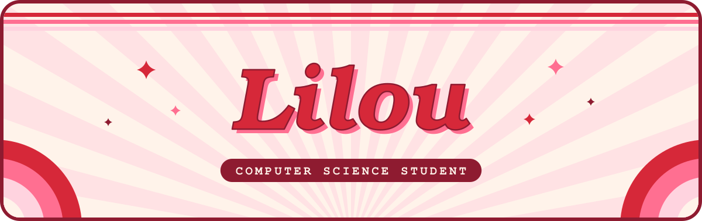

<!-- Header -->

  

  

  🇬🇧 <b>English</b> · 🇫🇷 <a href="README.fr.md">Français</a>

✦ · ✦ · ✦

### ★ About me

- 🎓 First-year **Bachelor in Computer Science** at **Coda**
- 📍 Based in **Dijon, France**
- 🎨 I want a career that matters: one that genuinely helps people and contributes to a better world. My artistic sensibility shapes the way I work: to me, a tool designed with care is a tool people actually enjoy using
- 🤝 Looking for a **work-study position (alternance)** starting **September 2027**
   ↳ Schedule: **3 weeks in the company / 1 week at school**

✦ · ✦ · ✦

### ★ Tech stack

<b>Already used in my projects</b>

  

<b>Learning this year</b>

  

  
  
  
  
  

✦ · ✦ · ✦

### ★ Projects

<table>
  <tr>
    <td width="50%" valign="top">
      <h4>🎨 <a href="https://github.com/lilouwalkowiak/Projet-C-B1-">SVG Shape Editor</a></h4>
      
A command-line shape editor written in C. Create ellipses, rectangles, lines, polylines and polygons from a pastel menu, style them (colours, rotation, flip…) and export the drawing to an <code>.svg</code> file.

      
<i>My very first project, started with no background in C.</i>

      
      
      
    </td>
    <td width="50%" valign="top">
      <h4>✨ Coming soon</h4>
      
<i>Web projects built from scratch are on the way this year.</i>

    </td>
  </tr>
</table>

✦ · ✦ · ✦

### ★ Currently

- ✅ Finished my first C project: the **SVG Shape Editor**
- 🌱 Learning **web development from scratch** (HTML, CSS, JavaScript, PHP) and **object-oriented programming**
- 🎯 Preparing my work-study search for **September 2027**

✦ · ✦ · ✦

### ★ Get in touch

  
  

<!-- Footer -->

  

